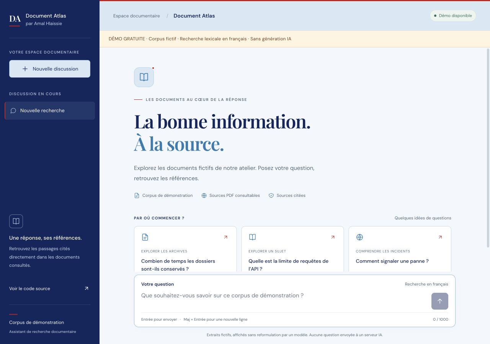

# Document Atlas

**A document-search demo with a multilingual Python RAG pipeline and a free, browser-only preview.**

Built by [Amal Hlaissie](https://github.com/amalofficiel) · Python · FastAPI · TypeScript · Qdrant · BM25

[Try the live demo](https://amalofficiel.github.io/document-atlas/) · [Evaluation](evaluation/REPORT.md) · [Architecture decisions](docs/architecture.md) · [Portfolio](https://ama-portfolio-murex.vercel.app/)

## Try it in one minute

1. Open the [public demo](https://amalofficiel.github.io/document-atlas/).
2. Ask **« Combien de temps les dossiers sont-ils conservés ? »** or **« Quelle est la limite de requêtes de l’API ? »**.
3. Open a source citation to check the original fictional PDF and page.

The live preview uses **lexical retrieval in the browser and displays original excerpts**. It does not call a language model or run the Python semantic pipeline. Questions stay in the browser. The full multilingual RAG pipeline runs locally with an optional Groq API key for generation.



## What this project demonstrates

- Extraction and chunking of PDF documents with page-level references.
- Semantic retrieval with multilingual Sentence Transformers and local Qdrant.
- BM25 keyword retrieval over the same indexed passages.
- Weighted reciprocal rank fusion (RRF) and multilingual cross-encoder reranking.
- FastAPI endpoints for questions, service health and source PDFs.
- A responsive TypeScript interface with citations, keyboard input and error states.
- A reproducible retrieval evaluation with bilingual questions, baselines and regression tests.

## Two clearly separated modes

| | Public web preview | Full local pipeline |
| --- | --- | --- |
| Retrieval | Browser lexical search | Semantic + BM25 + RRF + reranker |
| Language | French lexical matching | French/Arabic queries with multilingual models |
| Output | Unmodified source excerpts | Groq-generated answer with references |
| API key | None | Groq key for generation only |
| Data | Six fictional PDFs | The same fictional PDFs by default |
| Evaluation | UI/search regression checks | Measured retrieval benchmark below |

**No original BCT documents, private index, credentials or private Git history are included.** All sample rules and values are invented for this demonstration. Document Atlas is not affiliated with any institution.

## Measured retrieval results

The committed [evaluation report](evaluation/REPORT.md) compares six retrieval variants on **24 answerable questions (12 French, 12 Arabic), six fictional PDFs and twelve pages**. Four additional out-of-scope questions are recorded separately.

These are small-corpus diagnostic results, not a production-quality claim. They measure source-page retrieval, not answer correctness, citation entailment or regulatory accuracy. See the report for language breakdowns, timings, known failures and the limits of the protocol.

## Run the full RAG pipeline locally

Prerequisites: Python 3.10+, Node.js 22.12+ and npm. Models download at first use. The commands below target macOS/Linux.

```bash
git clone https://github.com/amalofficiel/document-atlas.git
cd document-atlas
python3 -m venv .venv
.venv/bin/python -m pip install -r requirements.txt
cp .env.example .env
npm --prefix frontend ci
```

Set `GROQ_API_KEY` in `.env` for generated answers. Preserve an existing `.env` if already configured. Never put the key in frontend variables.

```bash
# First run: create the local index; do this while the backend is stopped.
.venv/bin/python -m scripts.index_documents

# Terminal 1
.venv/bin/python -m uvicorn backend.main:app --reload

# Terminal 2
npm --prefix frontend run dev -- --host localhost --port 5173 --strictPort
```

Open http://localhost:5173 and the API docs at http://localhost:8000/docs. To rebuild an existing index, stop the backend and run the indexing command with `--reset` (replaces the local collection).

### Run only the free browser preview

```bash
npm --prefix frontend ci
VITE_DEMO_MODE=true npm --prefix frontend run dev -- --host localhost --port 5173
```

No Python backend or API key is needed in this mode.

## Reproduce the retrieval evaluation

The evaluation makes **no Groq calls**. Stop the backend first: the local Qdrant index can only be opened by one process at a time.

```bash
.venv/bin/python -m scripts.index_documents  # only if the index does not exist
.venv/bin/python -m scripts.evaluate_retrieval
```

Results are saved to `evaluation/results.json`. The default protocol uses `top_k=3`, `candidate_k=8`, equal RRF weights and both raw and reranked variants. To evaluate another compatible labeled corpus, provide `--queries /path/to/queries.json --output /path/to/results.json` against its corresponding index. Missing labeled pages fail validation; they are never silently omitted.

To regenerate the fictional PDFs (optional):

```bash
.venv/bin/python -m pip install -r requirements-dev.txt
.venv/bin/python -m scripts.build_demo_corpus
```

The authored text is stored in `evaluation/corpus.json`. Copies served by the browser are in `frontend/public/`.

## Checks

```bash
.venv/bin/python -m unittest discover -s tests -v
node --experimental-strip-types tests/demo-search.test.mjs
npm --prefix frontend run build
```

The CI workflow runs the retrieval regression tests, browser-search checks and both frontend build modes. It does not run paid generation calls or represent a full model-quality evaluation.

## Repository map

```text
backend/         FastAPI, PDF ingestion, retrieval, generation and source resolution
frontend/        TypeScript interface and browser preview
scripts/         Indexing, retrieval evaluation and fictional corpus generator
documents/       Six authored fictional PDFs
evaluation/      Ground truth, raw measurements and evaluation report
tests/           Ranking, filtering and browser-search regression tests
docs/            Architecture decisions and screenshots
```

## Current limitations

- The public preview is lexical and can return passages that do not fully answer the question.
- Retrieval has no calibrated abstention policy. Out-of-scope questions can still retrieve unrelated pages.
- The backend processes each question independently; chat history is not sent to the model.
- Scanned PDFs need OCR before ingestion.
- Generated answers and citation support have not been evaluated by this retrieval benchmark.
- Dependencies are not fully locked transitively; exact measured package versions are recorded in the results.

Next steps: a larger independently reviewed test set, calibrated abstention, citation validation and API-level integration tests.
