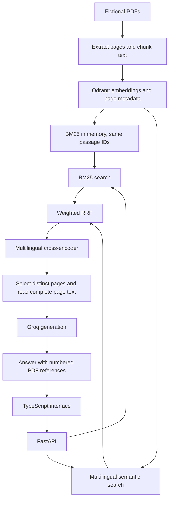

# Architecture and decisions

## Full local pipeline

## Why hybrid retrieval?

Semantic matching supports paraphrases and cross-language queries. Lexical matching preserves exact terms, identifiers and acronyms. RRF combines rank positions instead of adding incomparable cosine and BM25 scores. Equal weights are a starting configuration, not a claim of optimality.

## Why local Qdrant?

The local embedded index is simple to run for a portfolio project. It preserves payloads and stable IDs for both branches. The tradeoff is single-process index access: indexing and evaluation must run while the backend is stopped. A production service would need a deployment and concurrency strategy.

## Why rerank?

A cross-encoder compares each question-passage pair to refine ordering after retrieval. It adds latency and cannot recover a page absent from the candidate set. This is why the benchmark compares raw and reranked variants with a fixed candidate budget. Reranker outputs are logits, not calibrated probabilities.

## Public preview

The public GitHub Pages build uses `VITE_DEMO_MODE=true`. It downloads only the small authored corpus and performs BM25-style lexical scoring in TypeScript. It displays source excerpts unchanged, links to the fictional PDFs and labels the mode visibly. It never calls Groq or claims to run the Python benchmark pipeline.

The local build defaults to API mode. A Groq key stays on the server in `.env`. Never put a secret in a `VITE_` variable: those values are included in the browser bundle.

## Corpus and evaluation provenance

The public corpus and its questions were authored together for this demonstration. They contain invented operational rules; no real customer or institutional documents are used. A clean repository history separates the public example from the private BCT project.

The evaluation is a diagnostic source-page retrieval test. French and Arabic questions target French documents, making cross-language behavior visible. The labeled page is the one counted as relevant; other useful but unlabeled pages can be penalized by this simplified ground truth. No LLM-as-judge score is substituted for measured retrieval.

## Deployment

The source lives on `main`. The built static preview lives on `gh-pages`; `.nojekyll` preserves Vite assets. To update manually, build with `VITE_DEMO_MODE=true npm --prefix frontend run build -- --base /document-atlas/`, then deploy the resulting `frontend/dist/` to the publishing branch. CI verifies source builds; publishing is separate.
